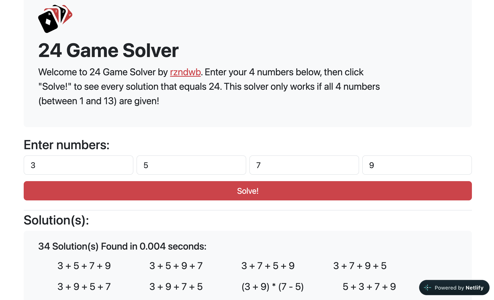

# 24 Game Solver

A web app that finds every way to make **24** from four numbers using `+`, `-`, `×`, and `÷`.

**[▶ Try it live](https://24-game-solver.netlify.app/)** <!-- TODO: update if your Netlify site name differs -->

<!-- TODO: add a screenshot, e.g. docs/screenshot.png -->
<!--  -->

## The game

You're dealt four numbers from 1 to 13 (like playing cards, with J, Q, K as 11, 12, 13). Combine all four, each exactly once, with addition, subtraction, multiplication, division, and parentheses so the result is 24.

For example, `3 3 8 8` has exactly one answer: `8 / (3 - 8 / 3)`.

## How it works

The solver is a complete brute-force search, which is small enough to be instant:

| Choice | Options |
|---|---|
| Order of the four numbers | 4! = 24 |
| Operator in each of the three slots | 4³ = 64 |
| Ways to group four operands | 5 |
| **Expressions checked** | **7,680** |

The five groupings are every binary tree with four leaves: `((a b) c) d`, `(a (b c)) d`, `(a b) (c d)`, `a ((b c) d)`, and `a (b (c d))`.

Two details make the results correct and readable:

- **Exact arithmetic.** Expressions are evaluated with fractions instead of floating point. Answers like `8 / (3 - 8 / 3)` pass through 8/3, which floating point can't represent exactly, so a plain `=== 24` check would miss them.
- **Minimal parentheses.** Each expression tree is printed with only the parentheses that operator precedence requires, and identical results are shown once.

## Tech stack

Node.js · Express · express-validator · Pug · Bootstrap · deployed on Netlify Functions

## Getting started

```bash
git clone https://github.com/rizanw/24-game-solver.git
cd 24-game-solver
npm install
npm run dev      # http://localhost:3000, restarts on changes
```

## Project structure

```
solver.js       search, exact fraction arithmetic, and expression formatting
main.js         Express app: form handling and input validation (1 to 13)
views/          Pug templates
assets/         icons and web manifest
netlify/        Netlify Function wrapping the Express app
netlify.toml    Netlify build and routing config
```

## Deployment

The app runs on [Netlify](https://www.netlify.com): Express is wrapped as a Netlify Function with [serverless-http](https://github.com/dougmoscrop/serverless-http), static files (icons, Bootstrap) are served from Netlify's CDN, and every other request is routed to the function. `netlify.toml` holds the whole setup, so connecting the repo in Netlify is enough. No build settings need to be entered in the UI.

## License

[MIT](LICENSE)
